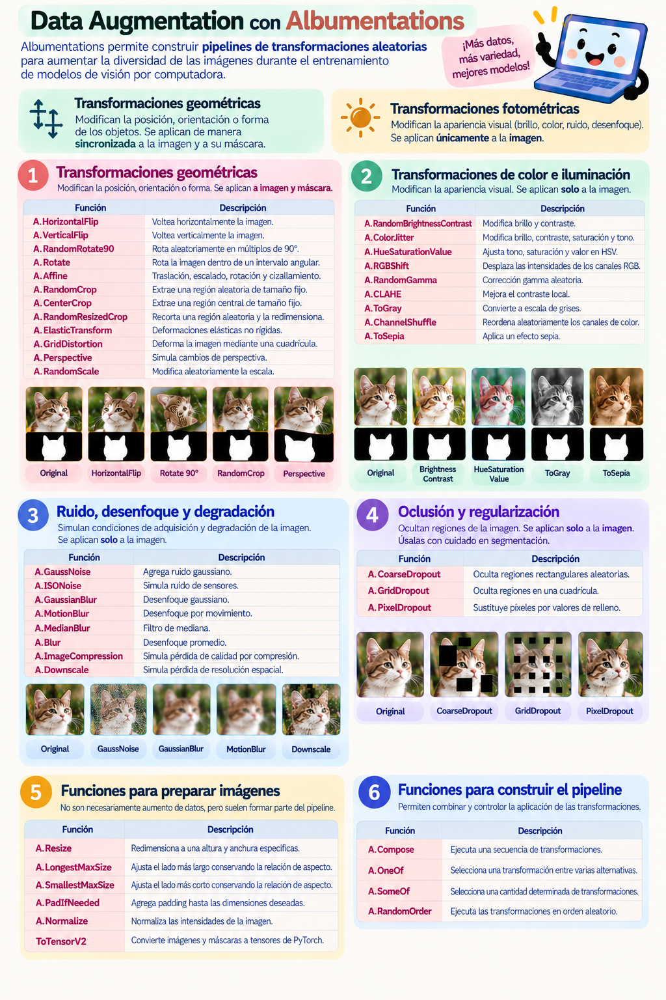

# 3.2 · Aumento de datos

Durante el entrenamiento de un modelo de Deep Learning, es importante que las imágenes utilizadas representen diferentes condiciones y variaciones de los objetos que queremos identificar.

Sin embargo, un dataset puede contener un número limitado de fotografías o presentar poca diversidad en aspectos como la orientación de los objetos, las condiciones de iluminación o la apariencia visual de las imágenes.

El **aumento de datos (*data augmentation*)** es una técnica que permite generar variaciones de las muestras existentes mediante transformaciones aleatorias, con el propósito de incrementar la diversidad de los ejemplos utilizados durante el entrenamiento y favorecer la capacidad de generalización del modelo.

En esta sección estudiaremos las **transformaciones geométricas y fotométricas**, identificando sus diferencias y comprendiendo cómo deben aplicarse cuando trabajamos con imágenes y máscaras de segmentación.

También conoceremos **Albumentations**, una biblioteca de Python que facilita la construcción de pipelines de transformaciones y permite mantener la correspondencia entre las imágenes y sus anotaciones.

---

## 🖼️ Transformaciones geométricas y fotométricas

Las operaciones de aumento de datos pueden clasificarse en dos grandes grupos según el tipo de modificación que realizan.

### 1 · Transformaciones geométricas

Las **transformaciones geométricas** modifican la posición, orientación, tamaño o disposición espacial de los elementos presentes en una imagen.

Algunos ejemplos son:

- Volteo horizontal (*Horizontal Flip*).
- Volteo vertical (*Vertical Flip*).
- Rotaciones.
- Traslaciones.
- Escalado.
- Recortes (*crops*).

En una tarea de segmentación semántica, estas operaciones deben aplicarse **de manera sincronizada a la imagen y a su máscara**.

Esto significa que ambas deben experimentar la misma transformación espacial para conservar la correspondencia entre los píxeles de la fotografía y las etiquetas de segmentación.

Por ejemplo, si una fotografía se voltea horizontalmente, su máscara también debe voltearse horizontalmente. De lo contrario, las regiones etiquetadas dejarían de coincidir con los objetos presentes en la imagen.

> [!IMPORTANT]
> **Las transformaciones geométricas deben preservar la correspondencia espacial entre la imagen y su máscara.**
>
> Además, cuando una operación requiere interpolación, las máscaras categóricas deben procesarse mediante **vecino más cercano**, para evitar la introducción de valores de etiqueta que no pertenecen a las clases originales.

### 2 · Transformaciones fotométricas

Las **transformaciones fotométricas** modifican la apariencia visual de una imagen sin cambiar la ubicación espacial de sus objetos.

Algunos ejemplos son:

- Modificaciones de brillo y contraste.
- Cambios de tonalidad y saturación.
- Ajustes de color.
- Adición de ruido.
- Desenfoque (*blur*).

Estas transformaciones se aplican **únicamente a la fotografía**, ya que las máscaras contienen etiquetas categóricas y no información de color o intensidad que deba modificarse.

Por ejemplo, podemos aumentar el brillo de una fotografía para simular una condición de iluminación diferente, pero su máscara debe conservar exactamente las mismas etiquetas.

> [!NOTE]
> Las transformaciones fotométricas modifican la apariencia de las imágenes, pero no alteran las etiquetas de segmentación.
>
> Por ello, una misma máscara puede seguir siendo válida para diferentes versiones fotométricas de una fotografía.

---

## 🔄 Aumento de datos sincronizado

Cuando trabajamos con segmentación semántica, cada muestra está formada por un par de archivos:

- **Imagen:** contiene la información visual que recibe el modelo.
- **Máscara:** indica la clase correspondiente a cada píxel.

El aumento de datos debe respetar esta relación.

| Tipo de transformación | Imagen | Máscara |
|---|---|---|
| Volteo horizontal o vertical | Se transforma | Se transforma de manera sincronizada |
| Rotación | Se transforma | Se transforma de manera sincronizada |
| Recorte | Se transforma | Se transforma de manera sincronizada |
| Escalado | Se transforma | Se transforma de manera sincronizada |
| Brillo y contraste | Se transforma | No se modifica |
| Cambios de color | Se transforma | No se modifica |
| Ruido | Se transforma | No se modifica |
| Desenfoque | Se transforma | No se modifica |

**La regla fundamental es que las transformaciones espaciales deben aplicarse al par imagen–máscara, mientras que las modificaciones de apariencia se aplican únicamente a la imagen.**

Esta distinción permite generar nuevas variaciones de las fotografías sin perder la validez de las anotaciones utilizadas para supervisar el entrenamiento.

---

## 🧰 Introducción a Albumentations

**Albumentations** es una biblioteca de Python especializada en transformaciones y aumento de datos para tareas de visión por computadora.

Permite combinar diferentes operaciones dentro de un **pipeline**, definiendo qué transformaciones pueden aplicarse y con qué probabilidad.

Una de sus principales ventajas para segmentación semántica es que permite procesar conjuntamente una imagen y su máscara, aplicando de forma sincronizada las transformaciones geométricas y reservando las transformaciones fotométricas para la imagen.

Entre sus características principales se encuentran:

- Transformaciones geométricas y fotométricas.
- Aplicación probabilística de operaciones.
- Composición de varias transformaciones en un mismo pipeline.
- Procesamiento sincronizado de imágenes y máscaras.
- Compatibilidad con arreglos de NumPy y flujos de trabajo de Deep Learning.

### Construcción de un pipeline

En Albumentations, los pipelines se construyen habitualmente mediante `A.Compose()`, que permite agrupar diferentes transformaciones.

Por ejemplo:

```python
import albumentations as A

transform = A.Compose([
    A.HorizontalFlip(p=0.5),
    A.RandomBrightnessContrast(p=0.3),
])
```

En este ejemplo:

- `A.HorizontalFlip(p=0.5)` tiene una probabilidad del 50 % de realizar un volteo horizontal.
- `A.RandomBrightnessContrast(p=0.3)` tiene una probabilidad del 30 % de modificar aleatoriamente el brillo y el contraste.

Cuando proporcionamos una imagen y su máscara:

```python
resultado = transform(
    image=imagen,
    mask=mascara
)

imagen_transformada = resultado["image"]
mascara_transformada = resultado["mask"]
```

Albumentations aplica el volteo horizontal de forma sincronizada a ambos elementos cuando se selecciona esa transformación.

En cambio, los cambios de brillo y contraste se aplican únicamente a la imagen.

> [!IMPORTANT]
> La probabilidad `p` indica la posibilidad de aplicar una transformación cada vez que se ejecuta el pipeline.
>
> Por lo tanto, **no todas las imágenes recibirán necesariamente las mismas transformaciones**.
>
> Además, el aumento de datos se aplica habitualmente durante el entrenamiento, sin necesidad de generar y almacenar permanentemente todas las versiones transformadas.

Puedes revisar más acerca de las transformaciones de albumentations [aquí →](https://albumentations.ai/docs/2-core-concepts/transforms/)

---

## 📋 Cheat sheet · Data Augmentation con Albumentations

La siguiente guía de consulta rápida reúne algunas de las transformaciones geométricas y fotométricas disponibles en Albumentations, junto con sus principales características y aplicaciones.



> [!TIP]
> Utiliza esta guía como referencia al construir tus propios pipelines de aumento de datos. La documentación de las funciones se puede consultar [aquí →](https://albumentations.ai/docs/api-reference/)
>
> Recuerda comprobar que las transformaciones seleccionadas sean adecuadas para las características de tu dataset y que no alteren información relevante para la tarea de segmentación.


---

## 🤔 Consideraciones para el entrenamiento

Aunque el aumento de datos permite incrementar la diversidad de las muestras, **no todas las transformaciones son apropiadas para cualquier dataset**.

Su selección debe considerar las características de los objetos, las condiciones de adquisición de las fotografías y la información que el modelo necesita aprender.

Por ejemplo, una rotación o un volteo puede ser útil cuando la orientación del objeto no determina su significado, pero podría resultar inadecuado en aplicaciones donde la orientación tiene importancia.

De manera similar, modificaciones excesivas de brillo, color o contraste pueden generar imágenes poco realistas o eliminar características relevantes.

También es importante distinguir entre las etapas de entrenamiento y evaluación:

- **Entrenamiento:** pueden aplicarse transformaciones aleatorias para aumentar la diversidad de las muestras.
- **Validación y prueba:** deben utilizarse procedimientos de preprocesamiento consistentes y deterministas, sin aplicar aumentos aleatorios destinados al entrenamiento.

Esto permite evaluar el comportamiento del modelo sobre muestras que no han sido alteradas aleatoriamente durante la evaluación.

---

## 🧪 Práctica

1. [Aumento de datos con albumentations →](../../practicas/03-procesamiento-de-imagenes-y-mascaras/02-aumento-de-datos.md)
2. [Estrategias de redimensionamiento con Albumentations →](../../practicas/03-procesamiento-de-imagenes-y-mascaras/03-estrategias-redimensionamiento.md)


---
## ➡️ Completa el reto del módulo

[Encuentra al gato →](../../practicas/02-ingenieria-del-dataset/07-reto-modulo-2.md)
<!--
---

## ➡️ Siguiente tema

Continúa con el siguiente tema del taller.
-->
---

[← Volver al índice de módulos](../modulos.md)

[← Volver a la portada del taller](../../README.md)